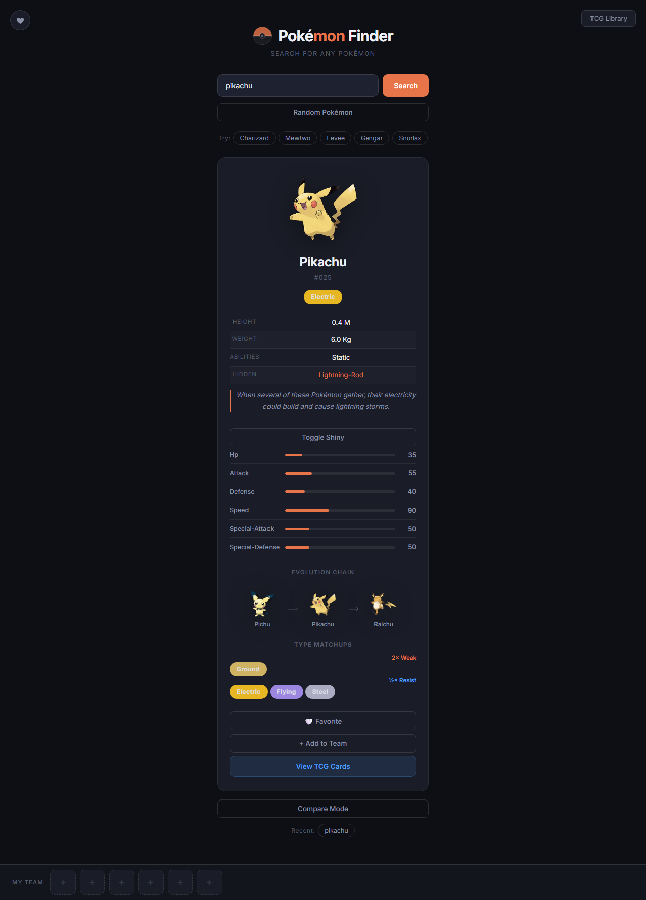
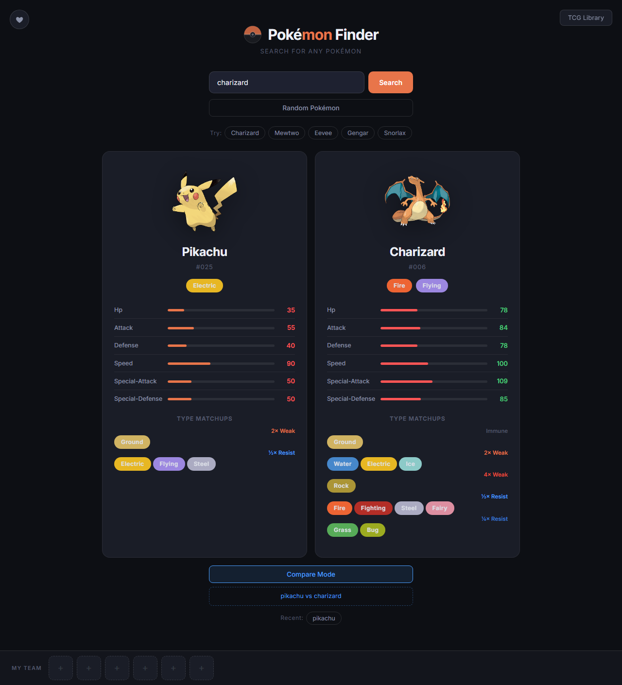
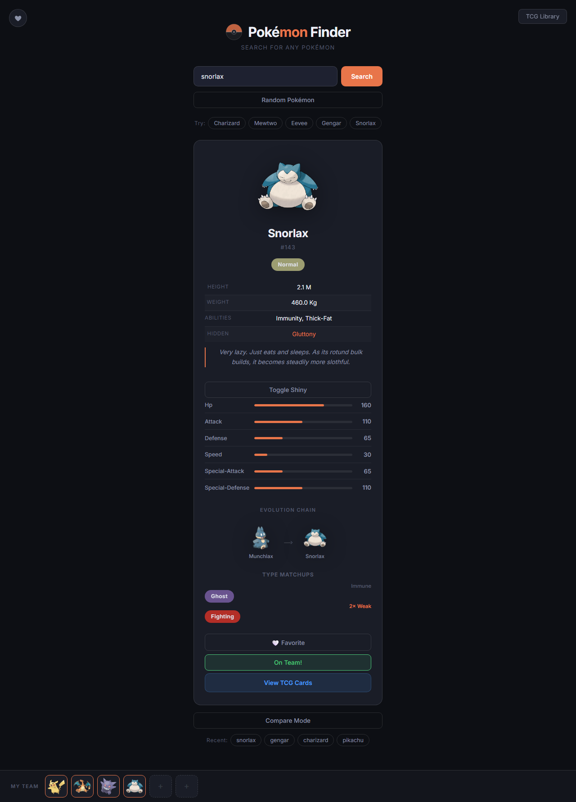
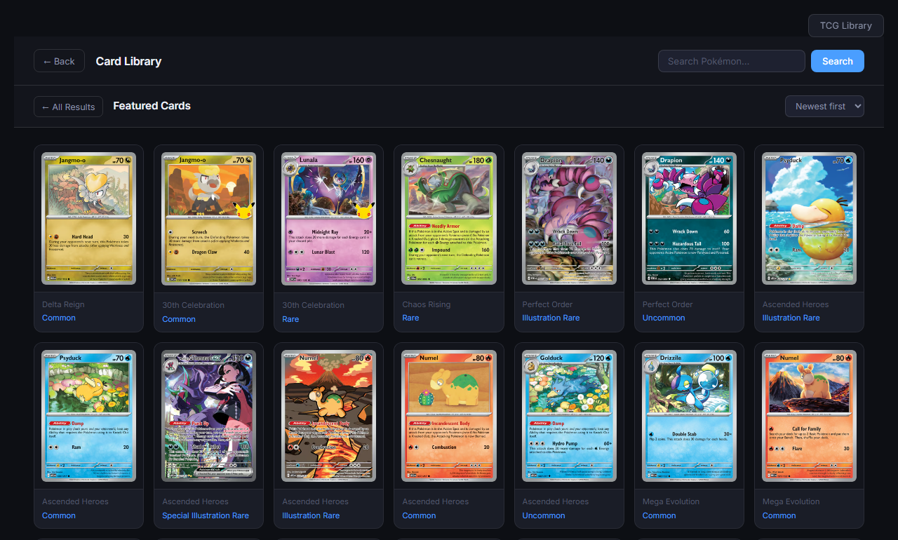

# Pokémon Finder (v1, archived)

> **This repository is archived.** It is the original version of Pokémon Finder,
> kept as a record of how the project started. The app was rebuilt in React:
> **[pokemon-finder-react](https://github.com/elpsykongroo14/pokemon-finder-react)**.
> The TCG API proxy both versions used now lives in
> **[pokemon-finder-tcg-proxy](https://github.com/elpsykongroo14/pokemon-finder-tcg-proxy)**.

A Pokédex-style web app for looking up any of the 1,025 Pokémon: sprites,
stats, type matchups, evolution chains and their official TCG cards. Built with
no framework, first in plain JavaScript, then migrated to TypeScript.

| Search result                                                                         | Compare mode                                                                        |
| ------------------------------------------------------------------------------------- | ----------------------------------------------------------------------------------- |
|  |  |

| Team and favorites                                                       | TCG library                                                                  |
| ------------------------------------------------------------------------ | ---------------------------------------------------------------------------- |
|  |  |

## What this version did

- Search by name or ID across all 1,025 Pokémon, with debounced autocomplete
  and keyboard navigation
- Stats, an 18×18 type-effectiveness chart, flavor text, abilities
- Evolution chains, including branching lines like Eevee's
- Side-by-side compare mode, a favorites drawer and a 6-slot team builder
  (stored in localStorage)
- A Pokémon TCG card library, proxied through a Cloudflare Worker so the API
  key never reached the browser
- Shareable, deep-linkable URLs

## How it was built

- TypeScript (migrated from vanilla JavaScript), ES modules, no framework
- Vite, Vitest (92 tests), ESLint, Husky pre-commit hooks
- GitHub Actions CI, deployed to Cloudflare Pages
- [PokéAPI](https://pokeapi.co/) and the [Pokémon TCG API](https://pokemontcg.io/)

## What I learned

This was my main project for learning software engineering as a self-taught
developer: DOM work and async code, breaking a 1,300-line `main.js` into
modules, XSS hardening, an API proxy with caching and rate limiting, unit
testing, CI, and a strict TypeScript migration that surfaced real bugs.

The whole story, entry by entry: [DEVLOG.md](./DEVLOG.md).

## Running it locally

```bash
git clone https://github.com/elpsykongroo14/pokemon-finder.git
cd pokemon-finder/pokemonfinderVite
npm ci
cp .env.example .env   # then set VITE_TCG_PROXY
npm run dev
```

The TCG library needs a deployed proxy. See
[pokemon-finder-tcg-proxy](https://github.com/elpsykongroo14/pokemon-finder-tcg-proxy).
Everything else works without it.
